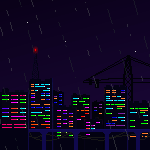

  

  

  

<h2 align="center">Contacto</h2>

  

<h2 align="center">Tecnologías</h2>

  

Pixel art: <a href="https://opengameart.org/content/neon-city-0">neon city</a> por <a href="https://opengameart.org/users/cottonball">cottonball</a> · <a href="https://creativecommons.org/publicdomain/zero/1.0/">CC0 1.0</a>

